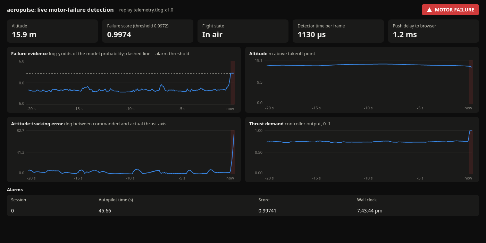
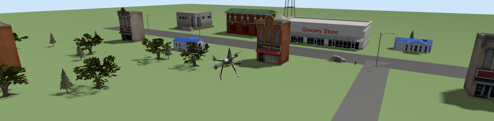

# aeropulse

Real-time motor-failure detection for PX4 drones, from flight logs to a live dashboard.

A quadcopter that loses a motor hits the ground about 1.4 seconds later. aeropulse reads the telemetry stream a ground station receives, scores it every 20 ms with a gradient-boosted model, and raises an alarm while the drone is still in the air. On held-out simulated flights it detects every motor failure before impact, with a median delay of 0.10 s and no false alarms.

The project also measures how far a model trained in simulation can be trusted on real drones, using public datasets of real flights with labelled faults.





## Contents

1. [Features](#features)
2. [Results](#results)
3. [How it works](#how-it-works)
4. [Repository layout](#repository-layout)
5. [Requirements](#requirements)
6. [Installation](#installation)
7. [Quick start](#quick-start)
8. [Usage](#usage)
9. [Reproducing the results](#reproducing-the-results)
10. [Development](#development)
11. [Troubleshooting](#troubleshooting)
12. [Limitations](#limitations)
13. [Datasets and acknowledgements](#datasets-and-acknowledgements)
14. [License](#license)

## Features

- **Batch pipeline.** Converts PX4 flight logs (ULog) into a Parquet data lake with a DuckDB catalog: signals aligned to a 50 Hz grid, per-row fault labels, windowed features and data-quality checks. It runs from the command line or as Dagster assets.
- **Offline fault models.** Isolation Forest, gradient-boosted trees, a physics rule and PX4's own estimator test ratios, evaluated with cross-validation grouped by recording day so that no day appears in both training and test data.
- **Simulation with fault injection.** PX4 v1.17 software-in-the-loop with Gazebo Harmonic in Docker. Scripted flights inject a motor failure over MAVLink, and the exact failure time is read back from the flight log.
- **Live detection service.** Reads the MAVLink stream (live, or a recorded `.tlog`), builds 0.5 s window features and serves a browser dashboard over WebSocket. Training and the live service share the same feature code, and a test checks that both produce identical scores.
- **3D flight view.** An optional Gazebo window follows the drone through a small town with buildings, trees, roads and vehicles.
- **Sim-to-real study.** Separates the simulation-versus-reality gap from the airframe gap and the fault-severity gap, using real, hardware-in-the-loop and simulated flights.

## Results

All numbers are produced by the commands in [Reproducing the results](#reproducing-the-results) and stored in `reports/`.

**Live detection** (16 held-out simulated flights, run against the live service, `reports/phase6/live_summary.json`):

| Metric | 50 Hz telemetry | Radio-rate telemetry (15/2/1 Hz) |
|---|---|---|
| Motor failures detected before impact | 8 of 8 | 8 of 8 |
| Failure-to-alarm delay, median (max) | 0.10 s (0.13 s) | 0.32 s (0.60 s) |
| Time left before impact at the alarm, median | 1.8 s | 1.56 s |
| False alarms on healthy flight | 0 | 0 |
| Detector compute time per frame, median | 1.0 ms | 1.9 ms |

**Simulation to real drones** (RflyMAD real quadcopters, frame-level average precision (AP), where 1.0 is perfect ranking and chance is about 0.17):

| Training data | Tested on real flights | AP |
|---|---|---|
| Gazebo simulation, motor fully off | real partial motor faults | 0.20 (chance level) |
| Hardware-in-the-loop simulation, same fault model | real partial motor faults | 0.70 |
| Real flights (cross-validated by day) | real partial motor faults | 0.89 |

Ranking transfers partly from hardware-in-the-loop simulation, but alarm thresholds do not: a threshold tuned on simulated flights gives hundreds of false alarms per hour on real flights. The full analysis is in [docs/phase7_sim2real.md](docs/phase7_sim2real.md).

## How it works

```
                    offline                                                   live
  PX4 flight logs (.ulg)                                  PX4 autopilot (simulated, or a recording)
          |                                                          |  MAVLink, UDP 14550
  pipeline: align to 50 Hz, label, features                          v
          |                                               reader thread -> frames -> 0.5 s windows
  data lake (Parquet + DuckDB)                                       |
          |                                               gradient-boosted model -> alarm logic
  models: train, cross-validate by day                               |
          |                                               FastAPI + WebSocket -> browser dashboard
  data/models/*.joblib  ---------------------------------------------^
```

| Stage | Module | Documentation |
|---|---|---|
| Data exploration | `scripts/explore_topics.py` | [docs/phase2_findings.md](docs/phase2_findings.md) |
| Batch pipeline | `aeropulse.pipeline`, `aeropulse.orchestration` | [docs/phase3_pipeline.md](docs/phase3_pipeline.md) |
| Offline models | `aeropulse.models` | [docs/phase4_models.md](docs/phase4_models.md) |
| Simulation and fault injection | `aeropulse.sim`, `docker/sitl` | [docs/phase5_sitl.md](docs/phase5_sitl.md) |
| Live detection and dashboard | `aeropulse.stream` | [docs/phase6_live.md](docs/phase6_live.md) |
| Sim-to-real study | `aeropulse.sim2real` | [docs/phase7_sim2real.md](docs/phase7_sim2real.md) |

The documents explain each design decision, the alternatives that were rejected, and the measurements behind them.

## Repository layout

```
.
├── run.sh                      one-command demo launcher
├── src/aeropulse/
│   ├── ingest/                 ULog reading
│   ├── align/                  causal alignment of signals to a common clock
│   ├── pipeline/               batch pipeline and data-quality checks
│   ├── orchestration/          Dagster asset definitions
│   ├── models/                 offline detectors and evaluation
│   ├── sim/                    simulator flights with fault injection
│   ├── stream/                 live detector, service and dashboard (static/dashboard.html)
│   └── sim2real/               sim-to-real experiments
├── scripts/                    dataset downloads and plots
├── tests/                      unit and integration tests
├── docker/sitl/                simulator image: Dockerfile, demo world, 3D view layout
├── docs/                       design write-ups and images
├── reports/                    results (CSV, JSON, PNG)
└── data/                       datasets, data lake and models (created locally, not versioned)
```

## Requirements

| Component | Needed for | Version used |
|---|---|---|
| Linux, x86-64 | everything | developed on Arch Linux |
| [uv](https://docs.astral.sh/uv/) | Python environment; installs Python 3.12 itself | 0.13 |
| [Docker Engine](https://docs.docker.com/engine/install/) | the simulator only | 29 |
| An X server (Xorg, or Xwayland on Wayland) | the 3D flight view only | Xwayland |

Disk space: about 1 GB for the Python environment, 15 GB for the simulator image, and up to 20 GB for the full datasets.

## Installation

**1. Install uv.** On Arch Linux:

```sh
sudo pacman -S uv
```

On other systems, follow the [uv installation guide](https://docs.astral.sh/uv/getting-started/installation/).

**2. Get the code and install the Python environment.**

```sh
git clone https://github.com/saiiexd/drone-fault-detection-system.git
cd drone-fault-detection-system
uv sync
```

`uv sync` creates `.venv/` and installs the exact dependency versions from `uv.lock`.

**3. Check the installation.**

```sh
uv run pytest
```

Expected result: all tests pass. Tests that need downloaded datasets or simulator logs are reported as skipped.

**4. Install Docker (only for the simulator).** On Arch Linux:

```sh
sudo pacman -S docker
sudo systemctl enable --now docker
sudo usermod -aG docker $USER
```

Log out and back in so the group change takes effect, then check with `docker run --rm hello-world`.

**5. Build the simulator image (only for the simulator).** This compiles PX4 and downloads the demo world's 3D models. It takes about 20 minutes, depending on the network, and creates a 15 GB image.

```sh
docker build -t aeropulse/px4-sitl:v1.17.0 docker/sitl
```

All commands in this README are run from the repository root, the folder that contains `pyproject.toml`.

## Quick start

The live dashboard needs a trained model and recorded flights in `data/`. If `data/` is empty, create them first with steps 5 and 6 of [Reproducing the results](#reproducing-the-results).

**Replay a recorded flight** (no Docker needed):

```sh
./run.sh
```

The dashboard opens at http://127.0.0.1:8000 and replays a 75-second simulated flight. Partway through, a motor fails: the failure score crosses the dashed threshold line and the status turns red with **MOTOR FAILURE**. Press Ctrl+C to stop.

**Fly a new simulated drone and watch it live** (needs Docker and the simulator image):

```sh
./run.sh live
```

Two windows open: the dashboard in your browser, and a 3D view of the drone flying through the demo town. The drone takes off, flies a random pattern, loses a motor and falls; the dashboard raises the alarm about 0.1 s after the failure. The run takes about two minutes. Press Ctrl+C to stop; this also removes the simulator containers.

`run.sh` stops a dashboard left over from an earlier run before it starts, so the browser always shows the current flight.

## Usage

### Live detection service

```sh
uv run python -m aeropulse.stream.service [options]
```

| Option | Default | Meaning |
|---|---|---|
| `--replay PATH` | none (live) | replay a recorded MAVLink stream (`.tlog`) instead of listening for a live one |
| `--speed X` | `1.0` | replay speed; `0` replays as fast as possible |
| `--url URL` | `udpin:0.0.0.0:14550` | MAVLink source in live mode |
| `--model PATH` | `data/models/stream_gbt.joblib` | detector model; `data/models/stream_gbt_radio.joblib` is trained for radio-rate telemetry |
| `--host`, `--port` | `127.0.0.1`, `8000` | dashboard address |
| `--session-dir PATH` | `data/stream/sessions/<time>` | where the decision log and, in live mode, the received stream are written |
| `--motor-lo`, `--motor-hi`, `--n-motors` | `0`, `1000`, `4` | motor output scale; real PX4 hardware reports PWM (`1000`, `2000`) |

Recorded flights to replay are in `data/raw/sitl6/`: `p6_motor_off_1` to `p6_motor_off_32` contain a motor failure, and `p6_nominal_1` to `p6_nominal_20` are healthy flights that should raise no alarm. For example:

```sh
uv run python -m aeropulse.stream.service --replay data/raw/sitl6/p6_nominal_2/telemetry.tlog --speed 4
```

The dashboard shows altitude, failure score, flight state, detector compute time and the delay to the browser; charts of the failure evidence, altitude, attitude-tracking error and thrust demand over the last 20 seconds; and a table of alarms. Every decision is also appended to `decisions.jsonl` in the session folder. The same data is available as JSON at http://127.0.0.1:8000/api/state.

### Simulated flights

```sh
uv run python -m aeropulse.sim.scenarios --out DIR [options]
```

| Option | Meaning |
|---|---|
| `--set {phase5,phase6,phase6_live}` | which list of scripted flights to fly (default `phase5`) |
| `--only NAME ...` | fly only the named flights, e.g. `live_motor_off_1` |
| `--world {default,town}` | Gazebo world: `default` is PX4's empty world, used for every recorded flight; `town` adds buildings, trees and vehicles |
| `--gui` | open the 3D view of each flight |
| `--no-tlog` | do not record the MAVLink stream; required while the live service is listening on UDP 14550 |
| `--skip-done` | skip flights already recorded in `DIR/runs.json` |

To watch a flight against the live service without `run.sh`, start the service in one terminal and fly in a second:

```sh
uv run python -m aeropulse.stream.service
uv run python -m aeropulse.sim.scenarios --out data/raw/demo --set phase6_live --only live_motor_off_1 --no-tlog --gui --world town
```

Each flight starts a fresh simulator container (`aeropulse-sitl`), and with `--gui` a second container (`aeropulse-gui`) that runs only the Gazebo user interface. Its camera follows the drone; drag with the mouse to look around. Both containers are removed when the flight ends. The `town` world has the same physics as the default world, and all scenery is at least 45 m from the flight area.

### Exploring the data

The processed UAV-SEAD flights are in a DuckDB database:

```sh
uv run python
```

```python
import duckdb
con = duckdb.connect("data/lake/aeropulse.duckdb", read_only=True)
con.sql("show tables")
con.sql("select flight_class, count(*) as flights from flights where usable group by 1 order by 2 desc")
```

To plot one flight's signals and fault labels:

```sh
uv run python scripts/plot_flight.py --lake data/lake --key 2019-01-07/08_40_52 --out reports/phase3
```

### Pipeline orchestration with Dagster

```sh
DAGSTER_HOME=$PWD/data/dagster_home uv run dagster dev
```

The Dagster UI opens at http://localhost:3000, with the data-lake asset, its lineage, its run history and five data-quality checks. Materializing the asset rebuilds `data/lake` from the logs in `data/raw/uav_sead/`.

## Reproducing the results

The steps build on each other. Times are approximate and depend on the machine and network.

**1. Download UAV-SEAD** (real flight logs with labelled faults):

```sh
uv run python scripts/download_uavsead.py --out data/raw/uav_sead --all
```

About 1,250 logs, 11.4 GB. Without `--all`, a 10-log sample (15 MB) is downloaded, which is enough to test the pipeline. Every file is checked against its SHA-256 checksum.

**2. Build the data lake:**

```sh
uv run python -m aeropulse.pipeline.run --raw data/raw/uav_sead --lake data/lake
```

Options: `--workers N` sets the number of parallel processes, `--limit N` processes only the first N logs, and `--with-raw` also stores every logged topic (about 6 GB).

| Layer | Path | Content |
|---|---|---|
| raw (optional) | `data/lake/raw/topic=*/flight_id=*/` | every PX4 topic as logged |
| cleaned | `data/lake/cleaned/flight_id=*/` | selected signals on a 50 Hz grid, with a label per row |
| features | `data/lake/features/flight_id=*/` | 2 s windows every 0.2 s |
| catalog | `data/lake/catalog/` | one row per flight: metadata, quality flags, label ranges |

**3. Train and evaluate the offline models:**

```sh
uv run python -m aeropulse.models.run        --lake data/lake --out reports/phase4 --models data/models
uv run python -m aeropulse.models.mechanical --lake data/lake --out reports/phase4 --models data/models
uv run python scripts/plot_phase4.py --pred reports/phase4/oof_predictions.parquet --out reports/phase4/pr_curves.png
```

**4. Fly the first simulator flights** (16 flights, about 20 minutes) and score them with the offline models:

```sh
uv run python -m aeropulse.sim.scenarios --out data/raw/sitl
uv run python -m aeropulse.pipeline.run --raw data/raw/sitl --lake data/lake_sitl
uv run python -m aeropulse.models.apply --lake data/lake_sitl --models data/models --out reports/phase5
```

**5. Record the live-detector training flights** (52 flights with their MAVLink streams, about 100 minutes):

```sh
uv run python -m aeropulse.sim.scenarios --out data/raw/sitl6 --set phase6
```

**6. Train the live detector:**

```sh
uv run python -m aeropulse.stream.dataset --raw data/raw/sitl6 --out data/stream/sitl6_frames.parquet
uv run python -m aeropulse.stream.train --frames data/stream/sitl6_frames.parquet --out reports/phase6 --models data/models
```

For the radio-rate model:

```sh
uv run python -m aeropulse.stream.dataset --raw data/raw/sitl6 --out data/stream/sitl6_frames_radio.parquet --radio
uv run python -m aeropulse.stream.train --frames data/stream/sitl6_frames_radio.parquet --out reports/phase6/radio --models data/models --radio --name stream_gbt_radio
```

**7. Evaluate the live service end to end** (16 held-out flights, about 35 minutes):

```sh
uv run python -m aeropulse.stream.live_eval --out reports/phase6 --data data/raw/sitl6_live
```

This starts the service, flies the `phase6_live` flights against it and scores its alarms against the failure times in the flight logs. If the flights are already recorded, add `--analyse-only` to re-score them without flying.

**8. Download RflyMAD** (real and hardware-in-the-loop flights, about 5.3 GB):

```sh
uv run python scripts/download_rflymad.py --out data/raw/rflymad --set real --per-group 12
uv run python scripts/download_rflymad.py --out data/raw/rflymad --set hil --per-group 12
```

**9. Run the sim-to-real experiments** (about 35 minutes, plus frame extraction):

```sh
uv run python -m aeropulse.sim2real.rflymad --set real --out data/stream/rflymad_real_frames.parquet
uv run python -m aeropulse.sim2real.rflymad --set hil --out data/stream/rflymad_hil_frames.parquet
uv run python -m aeropulse.sim2real.run --real data/stream/rflymad_real_frames.parquet --hil data/stream/rflymad_hil_frames.parquet --sitl-model data/models/stream_gbt.joblib --out reports/phase7
uv run python -m aeropulse.sim2real.octo_to_quad --out reports/phase7
uv run python -m aeropulse.sim2real.link_rate --out reports/phase7 --part real
uv run python -m aeropulse.sim2real.link_rate --out reports/phase7 --part sitl
```

## Development

```sh
uv run pytest                          # tests
uv run ruff check src scripts tests    # lint
```

GitHub Actions runs both on every push (`.github/workflows/tests.yml`).

Notable tests:
- `tests/test_stream.py` checks that replaying a recorded flight through the live detector reproduces the training pipeline's scores to within 1e-6, so the model sees the same features in service as in training.
- `tests/test_align.py` checks that signal alignment never uses future samples.
- `tests/test_pipeline.py` checks labelling, causal window features, data-quality rules and an end-to-end flight on synthetic data.

## Troubleshooting

| Symptom | Cause and fix |
|---|---|
| `No module named 'aeropulse'`, or files under `data/` not found | The command was run outside the repository root. Change to the folder that contains `pyproject.toml`. |
| `error: port 8000 is already in use` | Another dashboard is still running. Stop it with Ctrl+C in its terminal, or pass `--port 8001`. `run.sh` does this automatically. |
| The dashboard opens but stays empty | Live mode with no drone connected. Start a flight, or use `--replay`. |
| The live dashboard gets no data while a flight runs | The flight was started without `--no-tlog`, so it took UDP port 14550 from the service. |
| `permission denied ... /var/run/docker.sock` | Your user is not in the `docker` group, or you have not logged in again since adding it. |
| `Unable to find image 'aeropulse/px4-sitl:v1.17.0'` | Build the simulator image (Installation, step 5). |
| `--world town` fails, or buildings render black | The image was built before the demo world was added. Rebuild it. |
| No 3D window appears | `DISPLAY` is not set, or there is no X server. On Wayland, make sure Xwayland is running. |
| The pipeline finds no flights | `data/raw/uav_sead/` contains no `.ulg` files. Run step 1 of Reproducing the results. |

## Limitations

- **Simulation only for live detection.** The live detector is trained on simulated flights and does not transfer to real drones without real training data; see the results above.
- **One fault type in simulation.** In PX4 v1.17 with Gazebo, only "motor off" physically affects the vehicle. Sensor faults and stuck motors are accepted by the autopilot but have no physical effect, so they were not used.
- **Limited healthy flight time.** The zero-false-alarm result covers about 12 minutes of held-out healthy flight, which is too little to bound the false-alarm rate tightly.
- **Local network only.** The simulator runs on the same machine as the detector, so radio delay and packet loss are not exercised live. The radio-rate experiments use recorded real telemetry instead.

## Datasets and acknowledgements

| Dataset | Use | License |
|---|---|---|
| UAV-SEAD: Kabaoglu and Sariel, [arXiv:2602.13900](https://arxiv.org/abs/2602.13900), via [Hugging Face](https://huggingface.co/datasets/aykutkabaoglu/uav-flight-anomaly-dataset) | real flights, offline models | CC BY 4.0 |
| RflyMAD: Le, Quan et al., [arXiv:2311.11340](https://arxiv.org/abs/2311.11340), via Kaggle | real and hardware-in-the-loop flights, sim-to-real study | non-commercial research use |

Datasets are downloaded by the scripts in `scripts/` and are never committed.

The simulator uses [PX4 Autopilot](https://px4.io) (BSD 3-Clause) and [Gazebo](https://gazebosim.org) (Apache 2.0). The demo world's buildings, trees and vehicles are [Gazebo Fuel](https://app.gazebosim.org/OpenRobotics) models by Open Robotics, licensed CC0.

## License

The code is released under the [MIT License](LICENSE). The datasets keep their own licenses, listed above.
