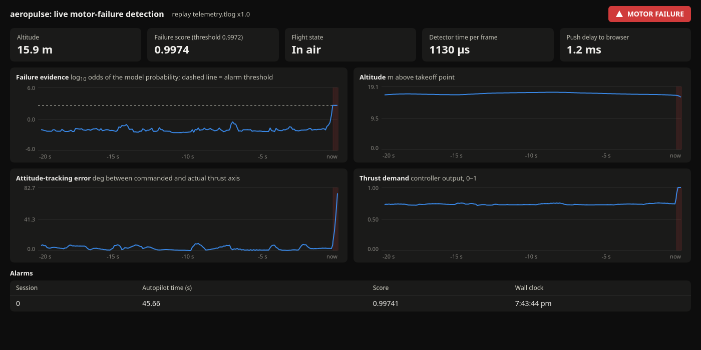

# Phase 6: live motor-failure detection on the MAVLink stream

Measured on 2026-11-09 (CachyOS host, PX4 v1.17.0 SITL in Docker, Gazebo x500 quadcopter).

Reproduce:
```sh
uv run python -m aeropulse.sim.scenarios --out data/raw/sitl6 --set phase6          # 52 flights, ~95 min
uv run python -m aeropulse.stream.dataset --raw data/raw/sitl6 --out data/stream/sitl6_frames.parquet
uv run python -m aeropulse.stream.train --frames data/stream/sitl6_frames.parquet --out reports/phase6 --models data/models   # ~4 min
uv run python -m aeropulse.stream.live_eval --out reports/phase6                    # service + 16 held-out flights, ~35 min
uv run python -m aeropulse.stream.service --replay data/raw/sitl6/p6_motor_off_5/telemetry.tlog   # dashboard demo
```

## 1. The problem phase 5 left

A quadcopter that loses a motor hits the ground about 1.4 s later (phase 5 §4). The phase 4 detector used 2 s windows and was trained on octorotor faults that develop over seconds. So it mostly reported the crash, not the failure. Phase 6 builds a detector for this specific job:
- it reads only what a ground station receives (the MAVLink stream), not the onboard log;
- it decides every 20 ms;
- it is judged on whether the alarm comes **before impact**.

## 2. Design

```
PX4 --UDP 14550--> reader thread --> FrameBuilder --> 0.5 s window features --> GBT --> persistence --> alarm
                        |                                                                   |
                   session.tlog                                                decisions.jsonl --> WebSocket --> dashboard
```

| Decision | Why | Alternative rejected |
|---|---|---|
| Train on recorded **MAVLink tlogs**, not on ULog signals | The live detector sees MAVLink (50 Hz, a subset of signals); training on the 250 Hz ULog would create training-serving skew | ULog features: more signals, but not available live |
| One frame per `ATTITUDE` message, other messages **sample-and-hold**, stale after 0.25 s | Causal by construction; a message that stops arriving turns into NaN instead of a frozen value | Resampling with interpolation: uses future samples |
| **0.5 s** window (25 frames) | Must be well under the ~1.4 s to impact | 2 s (phase 4): too slow for a quad |
| Same `FrameBuilder` and `window_features` code for training and live | No skew; `tests/test_stream.py` checks that replaying a tlog through the live detector reproduces the batch scores to 1e-6 | Separate batch and streaming code |
| Labels from the ULog's `vehicle_command` (injection) | The tlog and the ULog share the autopilot boot clock: on the same flight their roll angles agree at lag 0 (RMS 0.0002 rad) and differ by 1.2 rad RMS at ±20 ms | Wall-clock alignment: not exact |
| Frames **after impact** excluded from training and evaluation | After impact "did a motor fail?" is moot; PX4 often still says "in air" (phase 5 §4) | Keeping them: inflates recall with crash frames |
| **No message broker** (Kafka/Redpanda) | One vehicle, one consumer, one host: a broker adds a hop and operations for no benefit. The source sits behind `LiveLink`/`read_tlog`, so it can be swapped | Kafka: right for many vehicles or consumers, not here |
| Detector on a **plain thread**, not in the asyncio loop | Blocking UDP reads plus ~1 ms inference would stall the web server; a slow browser must never delay an alarm | All in asyncio |
| Browser gets 10 Hz + every alarm onset immediately | Charts don't need 50 Hz; alarms must not wait | 50 Hz push |
| Dashboard groups alarm onsets less than 10 s apart into one row, with a repeat count | After impact the wreck's telemetry makes the alarm flicker (up to 35 onsets in one crash); one row per episode keeps the table readable. Only the display groups them: the detector and `decisions.jsonl` keep every onset, which the evaluation needs to count false alarms | Latching the alarm in the detector: would hide repeated false alarms from the evaluation |

### Signals deliberately left out

- **Minimum motor output, motor spread and mean.** In SITL the injected motor's output is forced to 0 by the failure injector, so these features would encode the label, not the physics. A real broken propeller does not zero its commanded output. Phase 5 suggested "motor-command collapse" as a feature; that was a mistake.
- **Raw accelerometer extremes.** `HIGHRES_IMU` carries raw single-accelerometer samples, while the ULog (needed for phase 7) holds averaged ones. On the same SITL flight, instantaneous lateral acceleration from the two sources correlates at r = 0.07-0.18, and only the 0.5 s mean of vertical acceleration agrees (r > 0.97). Only that mean is kept.
- Absolute position, altitude and heading: they identify the flight, not the fault.

37 features remain. Each is the last value, mean, min and max over 0.5 s of: tilt, attitude-tracking error (the angle between the commanded and actual thrust axis), roll/pitch rate, yaw rate, vertical velocity, thrust demand, maximum motor output and saturated-motor fraction. On top of those come the window mean of vertical specific force, tilt and vertical-speed change, and peak angular acceleration.

### What the MAVLink stream contains

Measured on PX4 SITL's GCS link (UDP 14550): `ATTITUDE`, `ATTITUDE_QUATERNION`, `ATTITUDE_TARGET`, `LOCAL_POSITION_NED`, `SERVO_OUTPUT_RAW` at 50 Hz by default; `HIGHRES_IMU` is requested with `MAV_CMD_SET_MESSAGE_INTERVAL`. Gazebo's `SERVO_OUTPUT_RAW` runs 0-1000; real PX4 hardware sends PWM (1000-2000), so the scale is a per-vehicle setting (`MotorScale`).

## 3. Data

`phase6` scenario set (`src/aeropulse/sim/scenarios.py`), seeded and reproducible:
- **32 motor-off flights:** each motor 8 times, takeoff altitude 8-30 m, injection 6-25 s into a random waypoint pattern, cruise speed 3-10 m/s.
- **20 nominal flights.** Half are *aggressive*: cruise 7-10 m/s and climbs/descents of up to 14 m, so that "fast but healthy" is in the data.
- All 32 injections checked in the log: the motor command dropped from ≥ 0.71 to 0.0.
- 262,847 frames. 134,813 are airborne and before impact, and 2,989 of those are inside a failure. That leaves 0.73 h of airborne flight with no fault.
- Time from injection to impact: 1.28-2.58 s.

## 4. Offline results (5-fold cross-validation grouped by flight)

Thresholds come from an inner cross-validation on the training flights only. Rule: among thresholds with zero false alarms on validation, keep those that alarm before impact on the most fault flights, and take the geometric middle of that range. Phase 4 effectively took the lowest such threshold, and got a degenerate 0.001. Persistence: 3 consecutive frames (60 ms).

| Detector | Alarm before impact | Median latency | Worst latency | Median warning margin | False alarms (0.73 h) | Frame AP |
|---|---|---|---|---|---|---|
| **gbt_fast** | **32/32** | **0.096 s** | 0.112 s | **1.74 s** | 0 | 0.989 |
| rule_tilt_err (attitude-tracking error) | 32/32 | 0.348 s | 0.424 s | 1.48 s | 0 | 0.945 |
| rule_lift (mean vertical specific force) | 32/32 | 0.462 s | 0.504 s | 1.36 s | 0 | 0.928 |

- In phase 5, the phase 4 model at a usable threshold alarmed before impact in **0-3 of 8** flights. Here every failure is flagged in about 0.1 s, leaving 1.2-2.5 s of warning.
- **Two one-feature physics rules also catch every failure**, at 3.5-5× the latency. In simulation, a motor-off on a quad is not a hard detection problem. The value of the model is speed.
- The model leans almost entirely on **peak roll/pitch angular acceleration** (permutation importance 0.40; every other feature ≤ 0.001). A motor-off gives a violent, immediate torque imbalance. Phase 7 shows this is exactly why the model does not transfer to partial faults.
- **Zero false alarms in 0.73 h is weak evidence**, not proof: by the rule of three, the 95% upper bound on the rate is about 4 per hour.

## 5. Live end-to-end test

`stream/live_eval.py` starts the real service as its own process, bound to UDP 14550, and flies 16 **held-out** flights (`phase6_live`, new seeds) with nothing else recording. Everything below comes from the service's own decision log, joined with the ULogs afterwards.

| | Result |
|---|---|
| Motor failures alarmed before impact | **8/8** |
| Detection latency (autopilot clock) | median **0.102 s**, max 0.128 s |
| Warning margin before impact | median 1.80 s |
| False alarms | **0** in 0.20 h airborne (4 nominal + 4 inert-injection flights + pre-failure segments) |
| Detector compute per frame (host clock) | median **0.97 ms**, p99 2.1 ms, max 6.8 ms |
| Frame inter-arrival on the host | median 20.0 ms, p99 20.2 ms |

The live numbers match the offline cross-validation (median 0.096 s). Live, the service received 70,527 frames, and compute stayed far below the 20 ms frame budget.

**How latency is measured without trusting two clocks:**
- *Detection latency* uses only the autopilot clock: the alarm frame's `time_boot_ms` minus the injection time PX4 logged in the ULog on the same clock.
- *Compute latency* uses only the host's monotonic clock: message received → decision made.

The two are never subtracted from each other.

**The "controller-unaware" test did not happen, and why.** Four held-out flights used `CA_FAILURE_MODE=0`, meant as failures PX4 doesn't know about. The log check (phase 5's `fault_effect`) showed the motor **never stopped**: its command stayed at ~0.74 after injection. In PX4 v1.17 with Gazebo, the failure injector only *flags* the motor, and PX4's control allocator is what stops it, which happens only with `CA_FAILURE_MODE=1`. So:
- every SITL motor failure in this project is one PX4 knows about and re-allocates around;
- the four flights count as nominal (no alarms on them);
- a failure PX4 is unaware of can't be simulated with this setup. Phase 7 tests that case on RflyMAD, where faults scale the motor signal without PX4's knowledge.

Dashboard during a replayed failure (`p6_motor_off_5`): the alarm fires 0.10 s after injection, with the vehicle still at 15.9 m. The tracking error and thrust demand are only starting to move.



## 6. Engineering notes

- **Inference cost.** `HistGradientBoostingClassifier.predict_proba` on one row took 5.8 ms median (12.5 ms p99) with sklearn's default OpenMP threads, because starting threads costs more than the work. With `threadpool_limits(1)` it took 1.3 ms (1.7 ms p99). The service sets this at start.
- **Late joiners.** The server keeps the last 20 s of dashboard records and inlines them into the page, so a browser opened mid-flight draws at once.
- **Score display.** Final thresholds are around 0.997, so probabilities near 1 are unreadable on a 0-1 axis. The dashboard plots log10 odds instead.
- **Reboots.** A new SITL container restarts the autopilot clock. The detector starts a new session when frame time jumps backwards, so windows never mix two flights (tested).

## 7. Limitations

- **Simulation only.** Gazebo's x500 is noise-free compared with a real vehicle, and motor-off is the most violent fault there is. Phase 7 measures what happens on real flights.
- **The ground-station link of a real vehicle is slower.** RflyMAD's real telemetry radio logs carry `ATTITUDE` at 15 Hz, `ATTITUDE_TARGET` at 2 Hz and `SERVO_OUTPUT_RAW` at 1 Hz, with no quaternion or IMU messages. This 50 Hz model belongs on a companion computer wired to the autopilot. For a radio-linked ground station there is a separate radio-rate model (`stream_gbt_radio.joblib`, phase 7 §E): still 32/32 before impact in cross-validation and 8/8 on the held-out flights, at a median latency of 0.25-0.32 s instead of 0.10 s.
- **Transport latency is not measured.** SITL runs on the same host over loopback UDP. On hardware, MAVLink `TIMESYNC` would be needed to measure the link without trusting two clocks.
- 52 training flights from one simulator, one airframe and one PX4 version.
